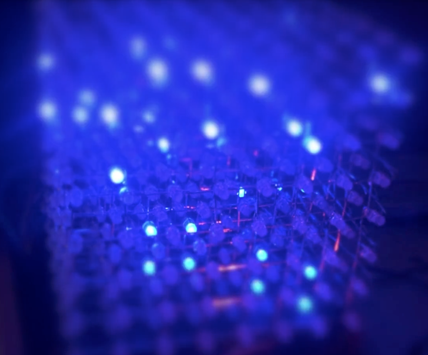
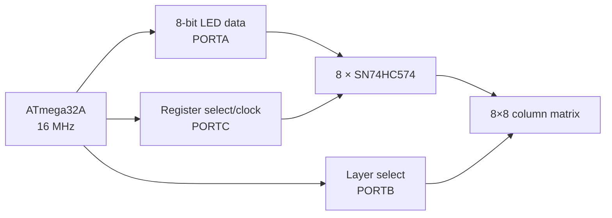
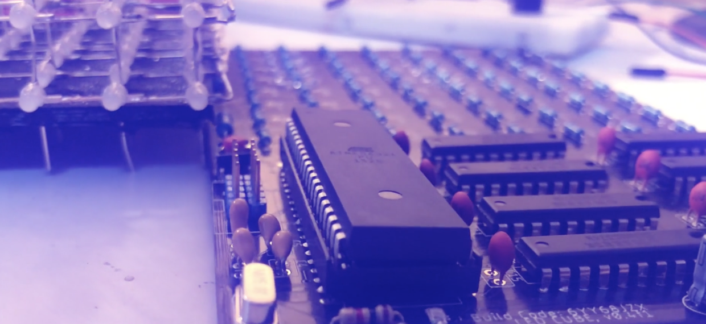
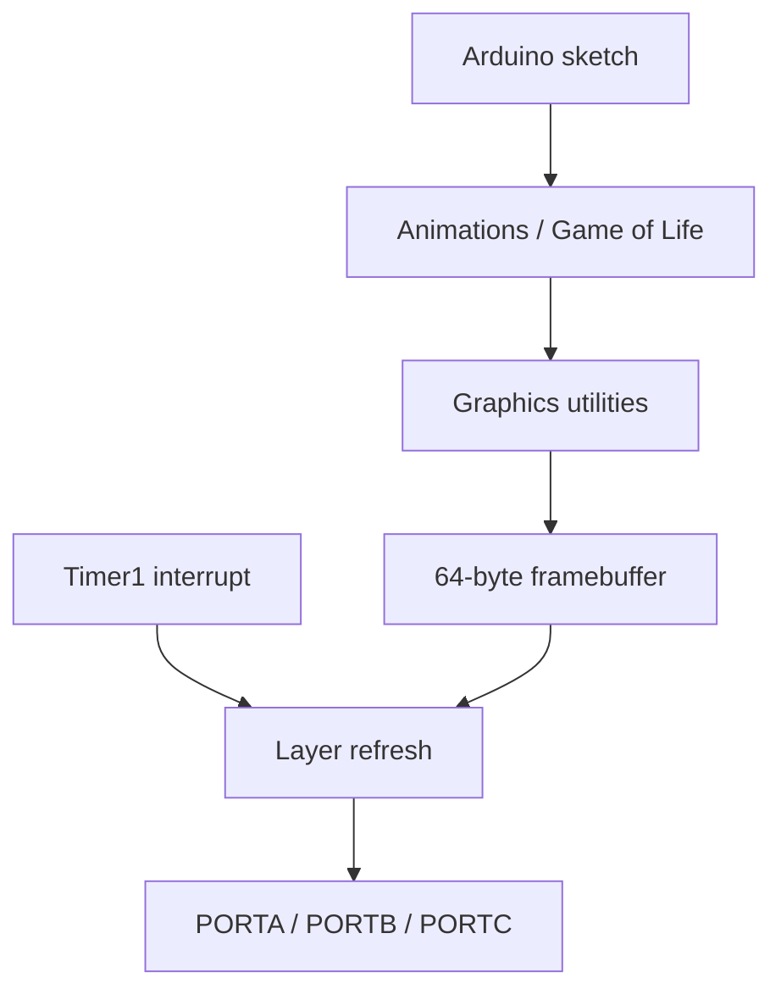

# Compact 8×8×8 LED Cube

[](https://www.microchip.com/en-us/product/atmega32a)
[](https://www.arduino.cc/)
[](https://www.microchip.com/en-us/products/microcontrollers-and-microprocessors/8-bit-mcus/avr-mcus)
[](https://www.autodesk.com/products/fusion-360/electronics-engineer)
[](LICENSE)

A compact **8×8×8 LED cube** driven by an ATmega32A microcontroller and eight SN74HC574 octal D-type flip-flops.

The cube contains 512 individually addressable LEDs. It uses timer-driven layer multiplexing, a compact 64-byte framebuffer, low-level voxel operations, animation utilities, and a three-dimensional cellular-automaton demonstration.



> **Safety notice:** This is a hobby electronics project. Verify the PCB, LED polarity, current-limiting resistors, supply capacity, and driver-current limits before powering the hardware. The project is provided without warranty.

## Features

- 8×8×8 LED volume
- 512 individually controlled voxels
- ATmega32A AVR microcontroller
- 16 MHz external crystal
- Eight SN74HC574 output registers
- Timer1-driven layer multiplexing
- 64-byte framebuffer
- Direct voxel set, clear, and read operations
- Linear 512-voxel addressing
- Vertical framebuffer shifting
- Randomized LED effects
- Rain and noise animations
- Three-dimensional cellular automaton
- Arduino-compatible firmware
- AVR ISP programming connector
- Autodesk EAGLE schematic and PCB files
- MIT License

## Hardware Overview



The ATmega32A controls the cube through three 8-bit GPIO ports:

| MCU port | Firmware role |
|---|---|
| `PORTA` | Supplies eight LED data bits |
| `PORTB` | Selects the active Z layer |
| `PORTC` | Selects and clocks the eight SN74HC574 registers |

The firmware displays one Z layer at a time. Rapidly cycling through all eight layers creates the appearance that the entire cube is illuminated simultaneously.

## Physical Construction



The hardware design uses:

- 512 LEDs for the final cube
- One ATmega32A microcontroller
- Eight SN74HC574 octal D-type flip-flops
- One 16 MHz crystal
- Current-limiting resistors
- Decoupling capacitors
- AVR ISP programming connector
- Custom controller PCB
- Suitable regulated power supply

It is advisable to purchase extra LEDs because inexpensive LEDs may have inconsistent brightness, color, or reliability.

## Display Multiplexing

The refresh routine runs from the Timer1 compare-match interrupt:

```cpp
ISR(TIMER1_COMPA_vect)
```

For each active layer, the firmware:

1. Disables the register clock/select bus.
2. Loads eight bytes representing the layer’s eight rows.
3. Pulses each corresponding SN74HC574 control line.
4. Enables one physical Z layer.
5. Holds the layer active briefly.
6. Disables the layer.
7. Advances to the next layer.

The eight layers are continuously refreshed in sequence:

```text
Layer 0 → Layer 1 → ... → Layer 7 → Layer 0
```

## Framebuffer Representation

The cube uses a 64-byte framebuffer:

```cpp
uint8_t vram[64];
```

Each byte stores eight X-axis voxels for one Y row at one Z layer.

The byte address is:

```text
address = z × 8 + y
```

The X coordinate selects one bit within the byte:

```text
bit = x
```

Therefore, the complete framebuffer contains:

```text
8 layers × 8 rows × 8 bits = 512 voxels
```

### Coordinate System

```text
x = 0...7  → bit position inside a framebuffer byte
y = 0...7  → row inside a layer
z = 0...7  → selected cube layer
```

Voxel access is implemented through:

```cpp
set_voxel(x, y, z);
reset_voxel(x, y, z);
get_voxel(x, y, z);
```

Coordinates are wrapped using modulo-eight addressing in the low-level graphics routines.

## Software Architecture



### Core Modules

| File | Purpose |
|---|---|
| `demo_firmware/demo_firmware.ino` | Basic hardware and voxel test |
| `gameoflife/LEDCUBE.ino` | Main Arduino sketch |
| `gameoflife/cube.c` | Framebuffer, voxel, refresh, and hardware-control functions |
| `gameoflife/cube.h` | Cube-control API |
| `gameoflife/cube_graphics.c` | Higher-level graphics utilities |
| `gameoflife/cube_graphics.h` | Graphics utility declarations |
| `gameoflife/gameoflife.c` | 3D cellular-automaton implementation |
| `gameoflife/gameoflife.h` | Cellular-automaton rule selection |
| `hardwares/core.sch` | Autodesk EAGLE schematic |
| `hardwares/core.brd` | Autodesk EAGLE PCB layout |

## Repository Structure

```text
LEDCUBE_8x8x8/
├── README.md
├── LICENSE
├── demo_firmware/
│   └── demo_firmware.ino
├── gameoflife/
│   ├── LEDCUBE.ino
│   ├── cube.c
│   ├── cube.h
│   ├── cube_graphics.c
│   ├── cube_graphics.h
│   ├── gameoflife.c
│   ├── gameoflife.h
│   └── build.sh
├── hardwares/
│   ├── core.sch
│   └── core.brd
└── img/
    ├── cube.png
    └── pcb.png
```

## Firmware Options

### Basic Demo Firmware

The demo firmware verifies the cube’s hardware and voxel addressing.

It:

- Initializes the AVR ports
- Configures Timer1
- Starts the refresh interrupt
- Iterates through all 512 voxels
- Clears and sets each voxel sequentially

Use this firmware first when bringing up a newly assembled cube:

```text
demo_firmware/demo_firmware.ino
```

### 3D Cellular Automaton

The `gameoflife` firmware implements a three-dimensional cellular automaton.

Each voxel evaluates its 26 surrounding neighbors:

```text
3 × 3 × 3 neighborhood − center voxel = 26 neighbors
```

The coordinate space wraps around the cube edges. Conceptually, the simulation therefore uses periodic boundary conditions rather than treating boundary voxels as having fewer neighbors.

At startup, the firmware randomly enables 90 of the 512 voxels and repeatedly advances the simulation.

## Cellular-Automaton Rules

Rule selection is controlled in:

```text
gameoflife/gameoflife.h
```

The current default is:

```cpp
#define _RULE_NEWS_
```

A live voxel survives when:

```text
RULE_EL ≤ neighbors ≤ RULE_EU
```

An inactive voxel becomes active when:

```text
RULE_FL ≤ neighbors ≤ RULE_FU
```

Several experimental rule sets are included:

- `_RULE_CONWAY_`
- `_RULE_34_`
- `_RULE_1021_`
- `_RULE_5766_`
- `_RULE_4526_`
- `_RULE_NEWS_`
- `_RULE_GROWCHAOS_`
- `_RULE_KEEPOSI_`
- `_RULE_RANDOMSHAPE_`

Enable only one rule definition at a time.

## Requirements

### Hardware

- Assembled LED cube and controller PCB
- ATmega32A microcontroller
- 16 MHz external crystal
- AVR ISP programmer, such as USBasp
- Stable power supply
- USB connection or serial adapter when serial monitoring is required

### Software

- Arduino IDE
- [MightyCore](https://github.com/MCUdude/MightyCore) AVR board package
- AVR-GCC toolchain
- AVRDUDE
- Autodesk EAGLE or compatible EAGLE-file viewer for PCB inspection

## Arduino IDE Configuration

The included historical build script indicates the following configuration:

| Setting | Value |
|---|---|
| Board package | MightyCore |
| MCU | ATmega32 |
| Pinout | Standard |
| Clock | 16 MHz external |
| Brown-out detection | 2.7 V |
| Link-time optimization | Enabled, optimized for size |
| Programmer | USBasp |

The exact menu names may vary with the installed MightyCore version.

## Uploading the Demo Firmware

1. Install the Arduino IDE.
2. Install the MightyCore board package.
3. Connect the USBasp programmer to the AVR ISP header.
4. Open:

   ```text
   demo_firmware/demo_firmware.ino
   ```

5. Select the ATmega32 board configuration.
6. Select the 16 MHz external clock.
7. Select **USBasp** as the programmer.
8. Burn the bootloader or fuse configuration if required.
9. Choose **Upload Using Programmer**.
10. Verify that the startup indicator flashes and the voxel test begins.

## Uploading the Game of Life Firmware

Open:

```text
gameoflife/LEDCUBE.ino
```

Confirm that the accompanying `.c` and `.h` files are in the same sketch directory, then upload using the ATmega32/MightyCore configuration.

The sketch initializes serial output at:

```text
115200 baud
```

A successful startup prints:

```text
Cube alive!
```

## Programming with AVRDUDE

The historical upload command uses:

```bash
avrdude \
    -p atmega32 \
    -c usbasp \
    -P usb \
    -U flash:w:LEDCUBE.ino.hex:i
```

The exact executable and configuration-file paths depend on the operating system and Arduino installation.

The included `gameoflife/build.sh` contains absolute paths from the original developer’s macOS environment and is not directly portable. Update those paths or use the Arduino IDE.

## Graphics API

### Voxel Operations

```cpp
set_voxel(x, y, z);
reset_voxel(x, y, z);
get_voxel(x, y, z);
```

### Framebuffer Operations

```cpp
reset_vram();
fill_vram();
vram_shift_down();
```

### Linear Voxel Access

```cpp
vram_bit_set(index);
vram_bit_reset(index);
vram_bit_get(index);
```

The linear index range is:

```text
0...511
```

It maps to coordinates as:

```text
x = index % 8
y = (index % 64) / 8
z = index / 64
```

## Creating a Custom Animation

A simple animation can be implemented by modifying the framebuffer through the voxel API:

```cpp
void loop() {
    reset_vram();

    for (uint8_t i = 0; i < 8; i++) {
        set_voxel(i, i, i);
    }

    delay(100);

    fill_vram();
    delay(100);
}
```

The Timer1 interrupt refreshes the display automatically while the main program updates the framebuffer.

Avoid disabling interrupts for extended periods because the cube depends on continuous multiplexing.

## Hardware Bring-Up Procedure

Use the following sequence when testing a new build:

1. Inspect the PCB for shorts and incorrect component orientation.
2. Verify all supply and ground connections.
3. Confirm the ATmega32A clock is running.
4. Program a minimal status-LED test.
5. Run the included demo firmware.
6. Verify each SN74HC574 output register.
7. Verify each physical layer independently.
8. Run the sequential 512-voxel test.
9. Check for reversed axes or incorrect layer ordering.
10. Run the Game of Life firmware after the basic test passes.

## Troubleshooting

| Symptom | Likely cause |
|---|---|
| No LEDs turn on | Missing power, incorrect AVR fuses, clock failure, or programming failure |
| Only one layer works | Layer-driver or `PORTB` connection problem |
| One row or column is missing | LED connection or SN74HC574 output problem |
| Layers flicker visibly | Refresh interrupt interrupted, wrong clock setting, or excessive ISR delay |
| Patterns appear mirrored | Physical axis wiring differs from framebuffer mapping |
| Upload fails | USBasp driver, ISP wiring, reset, or board configuration problem |
| Serial output is unreadable | Incorrect baud rate or MCU clock configuration |
| LEDs are excessively bright or hot | Incorrect current-limiting resistance or unsafe drive current |

## Hardware Files

The schematic and PCB were created in Autodesk EAGLE:

```text
hardwares/core.sch
hardwares/core.brd
```

Before manufacturing:

- Run electrical-rule and design-rule checks.
- Verify the board dimensions and layer stack.
- Confirm drill sizes and component footprints.
- Check LED polarity and connector orientation.
- Review supply-current requirements.
- Generate fabrication files from a verified copy of the design.

## Project Origin and Attribution

This project is based on the original `ledcube_8x8x8` work by **HaoYan Qi**, originally published under the GitHub username [`trulyspinach`](https://github.com/trulyspinach).

Original project:

[https://github.com/trulyspinach/ledcube_8x8x8](https://github.com/trulyspinach/ledcube_8x8x8)

This repository is maintained by [nguyen-ky2910](https://github.com/nguyen-ky2910) as a public copy for study, preservation, and further development.

## License

This project is distributed under the MIT License.

Original copyright:

```text
Copyright (c) 2019 HaoYan Qi
```

See [LICENSE](LICENSE) for the complete license text. Preserve the original copyright and license notice in copies or substantial portions of the project.
